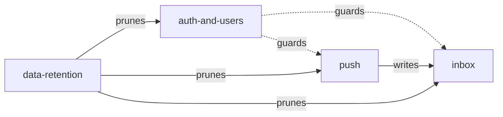

# Domain specs

Behavioural specs of what EdgeBase does today, one file per domain. Architecture lives in
[design.md](../design.md); the HTTP API in [api.md](../api.md).

Keep a spec true to the code: change it in the same commit as the behaviour it describes.

| Spec | Covers |
|---|---|
| [auth-and-users.md](auth-and-users.md) | sign-in methods, sessions, rate limit, captcha, native OAuth, account deletion, admin, 2FA, organizations, locale |
| [push.md](push.md) | devices, send API, idempotency, templates and translations, delivery and retry, stats, topics, scheduling |
| [inbox.md](inbox.md) | personal and broadcast items, cursor paging, read state |
| [data-retention.md](data-retention.md) | TTLs, cleanup cron, capacity |

